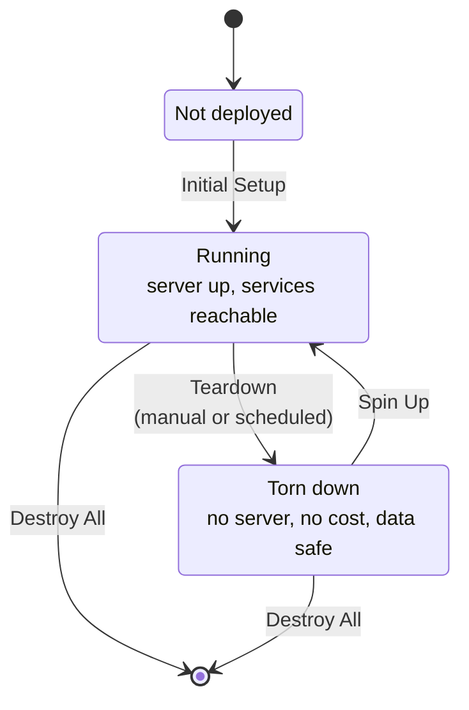

# Lifecycle

Most self-hosted setups have one state: running. Nexus Stack has three, and moving
between them is routine rather than exceptional.

The property to internalise: **the server is disposable, the data is not.** A
teardown really does destroy the machine. Nothing is paused or suspended — there is
no server left to pay for. Spin-up builds a new one and puts the data back.

## Why it works this way

Two reasons, and both are worth more than the complexity they cost.

**Cost.** A Hetzner server is billed by the hour. An environment that only exists
while somebody uses it — evenings, a class, two days of a workshop — costs a
fraction of one that idles 24/7. That is what turns "a real data stack" into
something a person or a course can afford.

**Reproducibility.** If rebuilding from scratch is a nightly routine, it cannot
quietly break. Configuration that only exists because someone once SSH'd in and
changed it does not survive the next cycle, which means it does not exist. Every
deployment is the deployment the code describes.

## The two lifecycle modes

Which pair of workflows a deployment uses is one setting — `lifecycle_mode` in the
Control Plane's D1 database, changed from the Settings page.

| Mode | Teardown does | Spin-up does | Data coverage |
|---|---|---|---|
| `rebuild` (default) | Snapshot the covered data to R2, then destroy everything | Provision a fresh `ubuntu-26.04` server and restore from R2 | The covered subset only |
| `snapshot` | Take a Hetzner disk snapshot, then destroy only the server | Restore the whole root disk from the image | Every stack on the disk |

`rebuild` is the fallback that always works, including across a server-architecture
change. `snapshot` is faster and covers every stack's data, at the cost of depending
on an image that must still be valid.

**Never dispatch one mode's workflow against a deployment configured for the
other.** A rebuild teardown rotates all service credentials, after which the
snapshot guard correctly refuses the image that was just taken. The full switching
and rollback procedure is in
[Snapshot Lifecycle](../admin-guides/snapshot-lifecycle.md).

## What survives a teardown

This is the question worth being precise about, because the answer is not "your
data" — it is "some of your data, depending on the mode".

**Always, in both modes:**

- Infrastructure state (the OpenTofu state in R2) — how the deployment knows what
  it has.
- Control Plane configuration in D1: which services are enabled, firewall rules,
  the lifecycle mode, the teardown schedule.
- The Control Plane itself. It lives in a separate OpenTofu root precisely so a
  teardown cannot take away the UI that brings the deployment back.
- The Cloudflare Access service token for Forgejo, when
  `ENABLE_FORGEJO_SERVICE_TOKEN` is on. It is a credential an external
  management plane holds, so its lifetime is the relationship between the two
  systems rather than the lifetime of a server: the teardown takes it out of
  the state and the spin-up imports it back (#892). See
  [Forgejo](../stacks/forgejo.md).

**In `rebuild` mode, service data only for the stacks the R2 layer covers.** That is
a hard-coded list in `src/nexus_deploy/s3_restore.py` (`standard_targets()`) —
currently Forgejo, Gitea, Dify, Metabase, HedgeDoc, Planka, DuckDB and the notebook
stacks (Jupyter, Marimo, code-server), plus dumps of the
shared Postgres database and of the Unity Catalog, Lakekeeper and MLflow catalogues. Two kinds of target sit in that list: a `pg_dump` of a
stack's database, and an rsync of the directories it writes — Forgejo and Gitea
have both, since a forge is repositories as much as it is a database. Read that function rather than trusting a number in a document:
the list grows when someone extends it, and this page will not notice.

Everything else — a topic you created in Redpanda, a dashboard you built in a stack
outside the list, files written inside a container — is **gone** on teardown. Not
corrupted, not recoverable: the disk it lived on no longer exists.

**A spin-up on a server that is already running restores nothing**, once that
server carries the restore marker. A spin-up writes `/mnt/nexus-data/.nexus-restored`
after both restore phases have finished. A later spin-up that finds the file skips
the restore and keeps the data on the server, because that data is newer than the
last teardown's snapshot. Before this guard (#926), re-running a spin-up on a live
server rolled every covered stack back to the last teardown. A rebuild teardown
destroys the disk and the file with it, so the spin-up after it always restores. If
persistence is on but an R2 credential is missing, the spin-up stops before any
stack starts, so nobody works in an empty stack that a later restore would overwrite.

Two cases the marker does not cover:

- **A server deployed before the guard** has no marker, so the first spin-up re-run
  on it still restores. Tear it down and spin it up once to get the marker.
- **A stack enabled later on a running server** does not get its saved database
  back. The Postgres restore skips any database whose container is not running, and
  the marker then stops later spin-ups from trying again. Enable such a stack, then
  tear down and spin up. Notebook and other filesystem targets are not affected: the
  restore brings every directory back, whether or not its stack is enabled.

**In `snapshot` mode, everything on the root disk survives**, because the whole disk
is imaged. That is the main reason to switch.

**Service credentials are regenerated, not preserved.** OpenTofu creates fresh
passwords on every spin-up and pushes them to Infisical. A password you wrote down
last week is not the password today; the Control Plane and Infisical always have the
current one.

## Scheduled teardown

A Cloudflare Worker runs daily and tears the deployment down if scheduled teardown
is enabled — the mechanism behind the "only pay for the hours you use" property. An
administrator policy can prevent the users of a deployment from switching it off,
which matters when the person paying the bill is not the person using the stack.

Spin-up stays manual: the deployment comes back when somebody asks for it, not on a
timer.

## One lifecycle run at a time

Every workflow that changes the server — Initial Setup, both spin-ups, both
teardowns, Destroy All and the upstream update — shares one GitHub Actions
concurrency group, `infrastructure`. A run dispatched while another is in progress
waits for it instead of working on the same server at the same time.

The one exception is the rebuild spin-up when Initial Setup or the snapshot
spin-up calls it as part of their own run: it then takes a group of its own and
relies on its caller, which already holds `infrastructure`. Joining the caller's
group would deadlock.

GitHub keeps at most **one** waiting run per group by default. A third dispatch
replaces the waiting one, which is cancelled. So a teardown queued behind a spin-up
is lost if somebody dispatches another spin-up before it starts; check the Actions
tab rather than dispatching again when a run seems slow. The Control Plane counts a
waiting run as running, so its buttons stay locked until it has finished.

GitHub's `queue: max` setting would keep up to 100 waiting runs instead. These
workflows do not use it yet: the actionlint version pinned in
`.pre-commit-config.yaml` rejects the key, and whether the Forgejo runner that also
runs these workflows accepts it has not been checked.

## Teardown is not Destroy All

| | Teardown | Destroy All |
|---|---|---|
| Server | Destroyed | Destroyed |
| Cloudflare Tunnel, DNS, Access apps | Destroyed | Destroyed |
| Control Plane, D1 configuration | Kept | Destroyed |
| R2 buckets (data snapshots, OpenTofu state) | Kept | Kept, unless you opt in to wiping them |
| Coming back | Spin Up | Initial Setup, from scratch |

Destroy All requires typing `DESTROY` to confirm, and wiping the R2 buckets and
Hetzner disk snapshots is a second, separate opt-in — so an accidental full
destruction still leaves the data behind.

## Practical consequences

- **Do not treat a running server as storage.** If it matters, it belongs in a
  covered stack, in a Git repository, or in R2.
- **Do not configure by hand over SSH.** The next spin-up will not know about it.
  Configuration belongs in the repository.
- **Test the cycle early.** A teardown and spin-up on day one tells you what your
  deployment actually preserves, at a point where losing it costs nothing.

## Related reading

- [Snapshot Lifecycle](../admin-guides/snapshot-lifecycle.md) — switching modes, and rolling back
- [Architecture](./architecture.md) — what runs during a spin-up
- [Stacks and services](./stacks.md) — which stacks hold data in the first place
