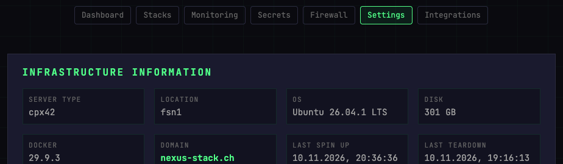
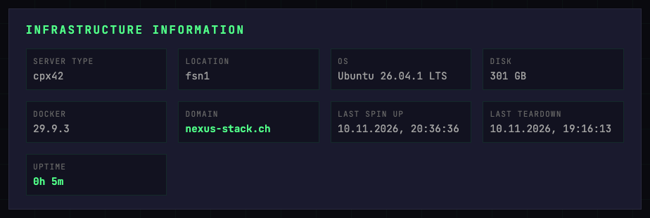
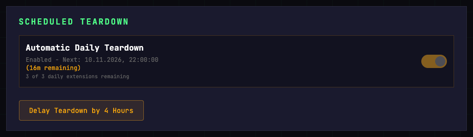
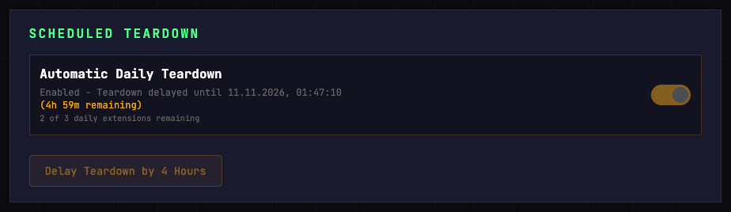
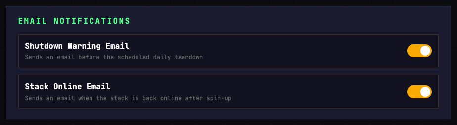

# Settings

The Settings page is split into five blocks: **Infrastructure Information** (read-only), **Scheduled Teardown**, **Lifecycle**, **Email Notifications**, and a list of **Recent Workflows**.

## Infrastructure Information

Read-only facts about the current deployment.

| Field | Description |
|-------|-------------|
| **Server Type** | Hetzner server model (e.g. `cx43`) — the one actually provisioned, which can differ from the one requested if that type was sold out |
| **Location** | Hetzner datacenter code — EU options: `hel1` (Helsinki), `fsn1` (Falkenstein), `nbg1` (Nuremberg); US option: `ash` (Ashburn) |
| **OS** | The distribution running on the box, read from it during the last spin-up |
| **Disk** | Root filesystem size. Not derived from the server type: a snapshot restored onto a larger type ratchets the disk permanently upward, so the two can legitimately disagree |
| **Docker** | Docker Engine version on the server |
| **Domain** | Your root domain |
| **Last Spin Up** | Timestamp of the most recent spin-up |
| **Last Teardown** | Timestamp of the most recent teardown |
| **Uptime** | Time elapsed since last spin-up |

To change server type or location, edit `config.tfvars` and re-deploy — the Control Plane can't change these on the fly.

**OS**, **Disk** and **Docker** are read from the server over SSH at the end of each spin-up. They show `—` on a stack that has not spun up since this was added, and after a teardown they keep the last reading rather than blanking — a value from the previous run is more useful than none, and there is no server to ask while the stack is down. If the collection fails, the spin-up still succeeds and logs a warning; the fields keep their previous values.

## Scheduled Teardown

The cron worker can auto-teardown your stack on a daily schedule so you don't pay for an idle server overnight.

- **Toggle** — Enable or disable the automatic daily teardown.
- **Next teardown** — Shows the scheduled time and how much time is remaining.
- **Extensions remaining** — How many times you can still delay teardown today (resets at UTC midnight).
- **Delay Teardown by 4 Hours** — Holds the teardown off until four hours from the moment you click, not four hours past the scheduled time. Useful when you're mid-session. Limited to 3 extensions per UTC day by default.

> If your admin has set `allow_disable_auto_shutdown = false`, the toggle is visible but locked — you can still use the delay button.

### Delaying tonight's teardown

If the **Shutdown Warning Email** arrives while you are still working — by default it is sent about 15 minutes before the teardown — the stack's administrator can open Settings and click **Delay Teardown by 4 Hours**; from anyone else the request is refused, so ask the administrator. The block then shows the new time and one extension fewer:

**A delay moves tonight's teardown; it does not cancel it.** When the scheduled time comes, the teardown stands down, and once the delay has ended the stack is torn down at the next check. The check runs every 15 minutes by default, so a teardown delayed until 01:47 happens at 02:00. A delay that ends before the scheduled time changes nothing: the teardown runs at its usual time. If the stack was torn down by hand in the meantime, nothing further happens. No second warning email is sent before the postponed teardown.

## Lifecycle

How your stack is torn down at night and brought back the next day. Both
options stop the server, which is where nearly all the saving comes from. They
differ in what survives, how long the spin-up takes, and — slightly — in cost:
Snapshot keeps disk images, and Hetzner bills those by used space. Measured on
a real stack that is roughly 10 GB used, two retained snapshots come to a
little under 30 cents a month. Small against a server, but not zero.

- **Rebuild** — Destroy everything and rebuild from a clean Ubuntu image each
  time. Container images are pulled fresh, so stacks tracking `:latest` stay
  current. What survives is only what the R2 backup covers, a fixed list of
  stacks: see [What survives a teardown](../concepts/lifecycle.md#what-survives-a-teardown).
  Data in a stack that is not on that list — dashboards you built in Grafana,
  for example — is gone the next morning.
- **Snapshot** — Take a disk snapshot before destroying the server and restore
  from it. Everything on the server survives, across all stacks, and the boot
  is faster because the system does not reinstall itself. In exchange the
  container images age: they stay at whatever was pulled when the snapshot line
  started. There is no refresh button yet — switching to Rebuild for one cycle
  is currently the only way to pull newer images, and that costs you everything
  the R2 backup does not cover.

The block always names the mode currently in use and what it means, so you can
read the setting even when you cannot change it.

> **Only the stack administrator can change this.** For everyone else the
> toggle is greyed out. Switching to Rebuild also asks for confirmation,
> because it cannot be undone: the next teardown regenerates every service
> password, and existing snapshots can no longer be restored after that.

Committing your work to the workspace repository is worth doing either way. The
repository lives in Forgejo, which is backed up under both options — it is the
one place your work is safe regardless of which mode the stack is on.

## Email Notifications

Two email notifications can be toggled independently:

- **Shutdown Warning Email** — Sent before the scheduled daily teardown as a heads-up.
- **Stack Online Email** — Sent when the stack is back online after a spin-up.

Both the admin and the stack's user can change these, since whether you get the mails is your own choice. Guests cannot.

Switching either toggle on also clears **silent mode**, a stack-wide setting that suppresses every automated mail. The page shows a banner while it is active. If both toggles already show as on and the banner is still there, switch one off and on again: only switching a toggle *on* clears it.

A single spin-up can also be started silently, so that it sends no stack-online mail. That choice exists only where the spin-up workflow is dispatched directly, such as in Nexus-Conductor or the repository's Actions page, not on the Control Plane's Spin Up button. It applies to that run only and does not change these toggles.

Both are sent via Resend using the API key configured during setup. If emails aren't arriving, check the Secrets page — `RESEND_API_KEY` should be under the global folder.
