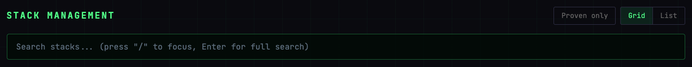
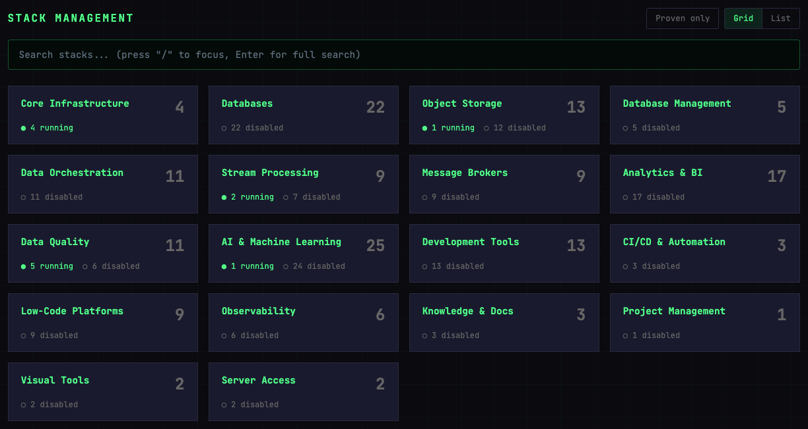
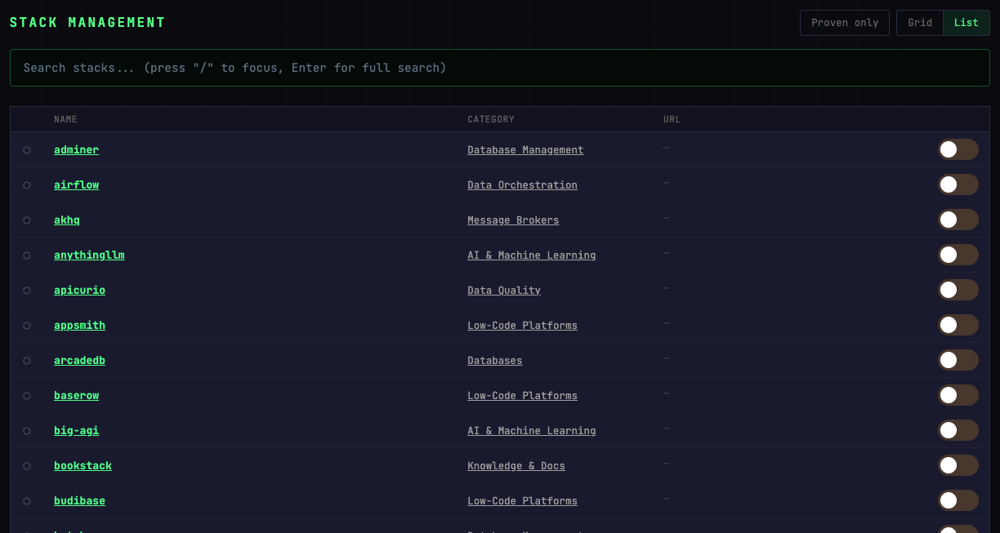
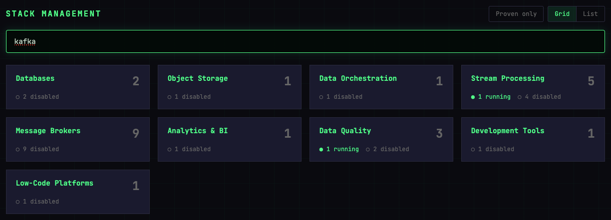
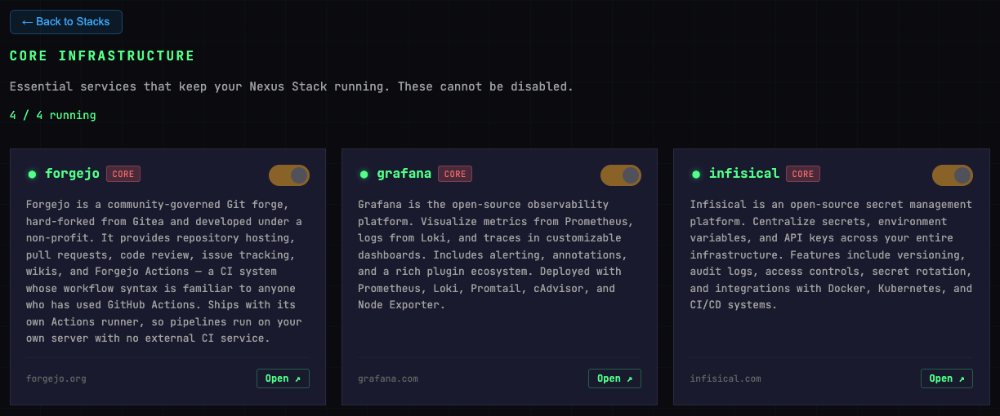

# Stacks

Your Nexus-Stack ships with a large catalogue of Docker services, grouped into categories (Data Engineering, ML/AI, Dev Tools, …). The **Stacks** page is where you turn them on, turn them off, and click through to their web UIs.

## Grid vs List

The **Grid** view (default) shows one card per category, with the number of stacks in it and how many are running or disabled. Click a card to open the category and see its stacks as tiles.

The **List** view is one flat table of every stack — better for searching by name or browsing all stacks at once.

Toggle between the two with the **Grid / List** buttons in the top right.

## Enabling and disabling a stack

Each tile on a category page has three controls (the List view has the same toggle in each row):

- **Toggle** — On/Off. The toggle records what you want; it does not start or stop anything yet. See [Applying your changes](#applying-your-changes).
- **Open** — Opens the service's web UI in a new tab. Links to the stack's subdomain (e.g. `https://grafana.<your-domain>`).
- **Website link** — bottom left, the project's own website (e.g. `grafana.com`).

### Applying your changes

A toggled stack is *staged*. The Dashboard shows a banner with the number of staged changes, and its **Spin Up** button reads **Deploy Changes (n)**. Click it to apply them: that starts the spin-up workflow, which starts the stacks you switched on and stops the ones you switched off. Until then a stack you switched off keeps running, and one you switched on does not exist yet.

## Search

Press `/` (or click the search box) and type. Matches on stack name, description, and image tag. Press `Enter` to switch to the List view with the same filter applied.

## Core stacks

A small set of services are marked **core** and cannot be disabled:

- **Forgejo** — Git server used by several integrations
- **Grafana** — monitoring and observability
- **Infisical** — secrets store
- **Portainer** — container dashboard, the first stop when a service misbehaves
- **SFTPGo** — browser for the deployment's object storage

Core stacks are shown with a **CORE** badge and their toggle is locked.

## Proven stacks

A few more stacks carry a **PROVEN** badge: code-server, Kestra, Marimo and Spark. They are the ones courses run on, and they are promised to work on every release, across a teardown and restore. Issues about them are fixed first. Unlike core stacks, you can switch them on and off like any other.

Click **Proven only** at the top of the Stacks page to list just these; it switches to the List view, and switching back to Grid clears the filter. Every other stack is *best-effort*: available, but not tested before each release. See [what each tier promises](../concepts/stacks.md#what-each-tier-promises).

## What happens when you disable a stack

Once the change has been deployed:

- The Docker container is stopped and removed
- Docker volumes with data (databases, object storage) are preserved
- DNS and Cloudflare Tunnel routes stay in place
- The stack's Cloudflare Access application stays (authentication rules persist)

Re-enabling is staged like any other change and applied by the next **Deploy Changes**, against the same volume — you get your data back.
